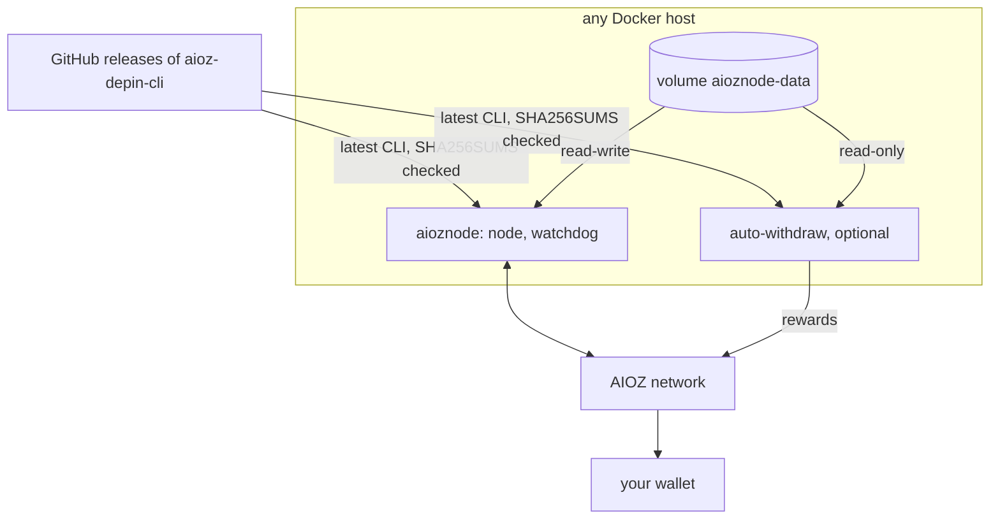

# AIOZ DePIN node in Docker

[](https://github.com/Rinzler78/aioz-node-docker/actions/workflows/tests.yml)
[](https://github.com/Rinzler78/aioz-node-docker/actions/workflows/pre-commit.yml)
[](https://github.com/Rinzler78/aioz-node-docker/releases)
[](https://hub.docker.com/r/rinzlerfr/aioznode)
[](https://hub.docker.com/r/rinzlerfr/aioznode)
[](LICENSE)

**An AIOZ DePIN node that runs itself: it updates, proves that it works,
restarts when it does not, and withdraws its rewards.**

A Docker image for an [AIOZ DePIN](https://aioz.network/aioz-node) node, on any
Docker host. Each start installs the latest upstream CLI; the health check
proves that the node answers and reads its rewards; an optional second
container withdraws the rewards to your wallet.

The repository is also a worked example of a small infrastructure project:
every rule it follows is written down, and most of them are checked by a test.



## Quick start

The commands run against any Docker context, local or remote
(`docker context use`, `DOCKER_HOST=ssh://user@host`). The node data lives in a
named volume: no folder of the host has to be known.

```sh
docker volume create aioznode-data
docker run -d --name aioznode --restart=always -p 1317:1317 \
  -v aioznode-data:/nodedata rinzlerfr/aioznode
docker logs -f aioznode    # until: Wallet successfully configured
```

> [!WARNING]
> At its first start the node creates a new wallet, and the volume holds the
> only copy of its key. Back the key up to a safe place, out of any clone:
> `docker cp` writes it on the machine that runs the command, not on a remote
> Docker host.

```sh
docker cp aioznode:/nodedata/privkey.json privkey.json
chmod 600 privkey.json
```

The node and the reward withdrawal together, from a clone of this repository:

```sh
WITHDRAW_ADDRESS_HEX=0xYourAddress docker compose up -d
```

[Running the image](docs/image.md#running-the-image) covers the rest: an
existing wallet, a host folder instead of the volume, the compose commands, and
the migration of a compose deployment that keeps its wallet in `./nodedata`.

## Configuration

* `WITHDRAW_ADDRESS_HEX` (required in withdraw mode): the `0x` address that
  receives the rewards.
* `WITHDRAW_MIN_VALUE` (`10^18`, 1 AIOZ): the balance, in attoaioz, above which
  the rewards are withdrawn.
* `CHECK_FREQ` (`60`): seconds between two withdraw checks.
* `RUN_TIMEOUT` (`86400`): seconds before the node stops, so that the container
  restarts and updates.
* `GITHUB_TOKEN` (unset): authenticates the release lookup.

Every setting, the watchdog timings included:
[environment variables](docs/image.md#environment-variables).

## Engineering practices

* **Self-updating, safely.** Each start checks the latest upstream release
  against its `SHA256SUMS`, and keeps the installed CLI when the update fails
  ([ADR 0001](docs/adr/0001-update-at-every-start.md)).
* **A health check that proves the function.** The node must answer and the
  wallet must read its rewards; after repeated failures a watchdog stops the
  node, so that the container restarts
  ([ADR 0002](docs/adr/0002-functional-health-check-and-watchdog.md)).
* **One image, two modes:** the node, or the reward withdrawal with the node
  data read-only ([ADR 0003](docs/adr/0003-one-image-two-modes.md)).
* **Upstream bugs handled, not hidden.** The node works around a broken
  upstream `start`, and a daily workflow reports what changes upstream
  ([ADR 0005](docs/adr/0005-run-the-embedded-aioz-io.md),
  [upstream watch](docs/ci.md#upstream-watch)).
* **Tested shell.** bats suites run in Docker, against fakes asserted on the
  `PATH` and real captures of the GitHub API and the CLI. Fitness tests turn
  the repository rules into tests, this page included.
* **Hardened delivery.** Workflows read-only by default, actions pinned to a
  commit and checked by zizmor, trivy scans; outdated hooks and actions block
  the commit; `latest` only moves to the highest release
  ([CI and release](docs/ci.md)).
* **Operated, not only built.** A host script reports when the node stops
  earning delivery rewards, and when it earns them again
  ([delivery watch](docs/delivery-watch.md)).
* **AI harness, model and tool agnostic.** One file, [AGENTS.md](AGENTS.md),
  instructs every coding agent; tests keep the tool-specific files from
  drifting ([AI harness](docs/ai-harness.md)).

## Documentation

* [The image](docs/image.md): running it beyond the quick start, the
  Dockerfile, the scripts, the settings, the build and the tests.
* [Delivery watch](docs/delivery-watch.md): a host script that tells when the
  node stops earning delivery rewards.
* [CI and release](docs/ci.md): the pre-commit hooks, the release of the
  public image, the upstream watch.
* [Architecture](docs/architecture.md): how the containers, the delivery watch
  and the release pipeline fit together.
* [Decision records](docs/adr/README.md): why they are built that way.
* [AI harness](docs/ai-harness.md): how coding agents work on this
  repository.
* [CHANGELOG.md](CHANGELOG.md): the changes of each release.

## Contributing

Issues and pull requests are welcome: see [CONTRIBUTING.md](CONTRIBUTING.md).
Report a vulnerability privately, as [SECURITY.md](SECURITY.md) describes,
never in a public issue.

## Support

If you find this project useful, please consider donating:

* AIOZ: `0x4D11B64d9bb0652a92FCaD019d7Fc79f14821571`
* AIOZ (bech32): `aioz1f5gmvnvmkpjj4yhu45qe6l78nu2gy9t3mklmct`

## License

[MIT](LICENSE)
