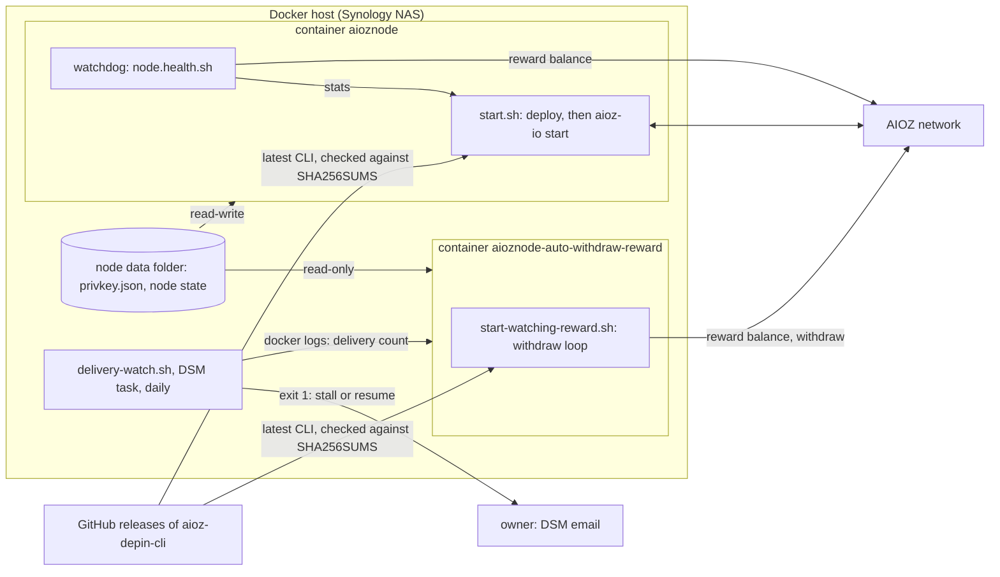
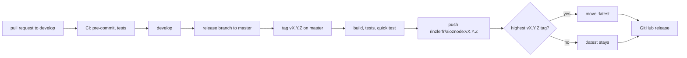

# Architecture

One Docker image runs an AIOZ DePIN node and, started with another command,
withdraws its rewards. The image installs the latest upstream CLI at every
start, so a release of this repository changes the scripts around the node, not
the node itself. `tests/docs.bats` checks that this page names every
`<name>.sh` script, workflow and Dockerfile of the repository, the compose
file and the `Makefile`.

## Runtime

In production the two containers run from `docker-compose.yml` on a Synology
NAS, next to a host script that watches the delivery rewards.

### The node container

`tools/start.sh` is the entry point (`CMD` of the `Dockerfile`):

1. It refuses a timing setting that is not a whole number
   (`tools/number.lib.sh`).
2. `deploy` (`tools/deploy.sh`) updates the Alpine packages (`tools/dist.sh`),
   installs or updates the CLI from the latest upstream release after checking
   its checksum (`tools/node.install.sh`, which reads the release with
   `tools/git.releases.latest.sh` and skips the update when the installed
   version, read with `tools/version.lib.sh`, is already the latest), extracts
   the matching `aioz-io` (`tools/node.io.sh`), creates the wallet when the
   data folder has none (`tools/wallet.configure.sh`), then removes the
   packages of other kernels and the package cache.
3. It runs `aioz-io start` for `RUN_TIMEOUT` seconds (24 hours by default),
   with upstream auto-update off: updates run at each start instead.
4. A watchdog runs `tools/node.health.sh` every `HEALTH_INTERVAL` seconds. The
   check proves the function, not the process: the node answers `aioz-io
   stats` and the wallet reads its balance. After `HEALTH_RETRIES` failures in
   a row it stops the node.

When the node stops, for either reason, the container exits and the restart
policy starts it again, which runs the update again. Docker never restarts an
unhealthy container itself, hence the watchdog; the image `HEALTHCHECK` runs
the same check with the same default timings, so `docker ps` shows the same
verdict (`tests/image.bats`).

The CLI of the release is a wrapper around two embedded binaries, and its
`start` is broken upstream: the scripts run the embedded `aioz-io` directly
(README, Node binary).

### The withdraw container

The same image started with `tools/start-watching-reward.sh` refuses a
`WITHDRAW_ADDRESS_HEX` that is not a `0x` address of 40 hex digits, runs
`deploy`, then calls `withdraw_reward` (`tools/withdraw.reward.sh`) every `CHECK_FREQ`
seconds: once the balance exceeds `WITHDRAW_MIN_VALUE`, it withdraws all of it
to `WITHDRAW_ADDRESS_HEX`. `aioz-io` reads and withdraws the rewards from the
network with the wallet key: no local node is involved. The node data folder is
mounted read-only, so this container can never create a wallet of its own.

### The delivery watch

`nas/delivery-watch.sh` runs on the NAS host, not in the image: the hub serves
the delivery count to the wallet key only, so the watch reads the count that
the withdraw container logs. It exits 1 once per event (deliveries stalled for
`STALL_HOURS`, resumed after a stall, a count going down, an invalid state
file), and on every run while the logs hold no count, the state cannot be
written or a setting is invalid. The DSM task scheduler emails the output of
a task that ends abnormally.

## Delivery

The workflows:

* `.github/workflows/pre-commit.yml`, on a pull request and after a merge into
  `develop` or `master`: every hook of `.pre-commit-config.yaml`, on the
  changed files, then on every file after a merge;
* `.github/workflows/tests.yml`, on a pull request and after a merge into
  `develop` or `master`:
  `tests/run.sh`, the bats tests of the image and NAS scripts and the fitness
  tests of the repository;
* `.github/workflows/upstream-watch.yml`, daily and on demand: the tests of
  the CI scripts, then `.github/scripts/upstream-watch.sh`; on a pull request
  that changes `.github/scripts/` or this workflow, only the tests of the CI
  scripts;
* `.github/workflows/docker-image.yml`, on a `v*` tag: build, `tests/run.sh`,
  `scripts/quick_test.sh`, push, GitHub release.

The CI scripts; the first three are tested against fakes by
`.github/scripts/tests/run.sh`:

* `.github/scripts/push-latest.sh` moves `:latest` only to the highest
  `vX.Y.Z` tag, read at push time: a fix on an older line never sends the
  hosts that follow `:latest` back. It shares the tag pattern of
  `.github/scripts/release.lib.sh`.
* `.github/scripts/upstream-watch.sh` reports what changed upstream (hubs,
  releases, the issue of the broken `start`) on a tracking issue, measured
  against its own last report.
* `.github/scripts/deps-freshness.sh` fails the commit when a hook or a
  workflow action is not on its latest release.
* `.github/scripts/image-vuln-scan.sh` builds the image and fails on a HIGH or
  CRITICAL vulnerability. It has no test of its own: it runs trivy on a real
  build, as a pre-commit hook.

Two jobs get a write token, each for one thing: the release job of
`.github/workflows/docker-image.yml` (`contents`, to create the release) and
the watch job of `.github/workflows/upstream-watch.yml` (`issues`, to comment
on the tracking issue). The Docker Hub credentials are restricted to `v*` tags.

## Local development

The `Makefile` lists the commands; each target runs one script:

* `scripts/helper.docker.build.sh`, `scripts/helper.docker.run.sh`,
  `scripts/helper.docker.stop.sh`, `scripts/helper.docker.start.sh` and
  `scripts/helper.docker.clean.sh` build, run, stop and clean a local
  container, with the shared functions of `scripts/helper.docker.lib.sh`;
* `scripts/quick_test.sh` builds the image, waits until it is healthy and
  checks, in the container, that the installed CLI version
  (`tools/node.version.sh`) is the latest release
  (`tools/node.remoteVersion.sh`) (network);
* `tests/run.sh` and `.github/scripts/tests/run.sh` run the bats suites in
  Docker (the first in the image of `tests/Dockerfile`, with bats and make),
  against fakes and real captures. The fakes of `gh`, `curl`, `git`,
  `pre-commit` and `docker` are in `.github/scripts/tests/fakes/`.

## Script structure

Every script defines its functions first and ends with a guarded entry point,
so sourcing it runs nothing. A script that needs another one sources it and
calls its functions: a container start is one shell process, plus the CLI and
the system tools. In the image, the only script run as a child process is
`tools/node.health.sh`, because the watchdog bounds it with `timeout`; outside
it, `scripts/quick_test.sh` runs the two version scripts in the container
with `docker exec`. `tests/scripts.bats` enforces both rules on every script
of the repository, with these two exceptions.

## Trust boundaries

* The wallet key stays in the node data folder of its host: git and the Docker
  build context ignore it (`tests/harness.bats`), and the withdraw container
  mounts it read-only.
* Upstream binaries are checked against the `SHA256SUMS` of their release
  before they replace the installed CLI; a failed update keeps the installed
  one.
* The timing settings of `tools/start.sh`, the health check timeout and the
  numbers of the delivery watch (settings, state file, container logs) are
  checked as whole numbers before use, and the upstream watch trusts only its
  own reports on a public issue. In the withdraw mode, the address that
  receives the rewards is checked before anything runs. Not checked yet there:
  `CHECK_FREQ` goes to `sleep` and `WITHDRAW_MIN_VALUE` (a `bc` expression) to
  `bc` as set, and the balance that `aioz-io reward balance` returns goes to
  `bc` and to the withdraw command as read.
